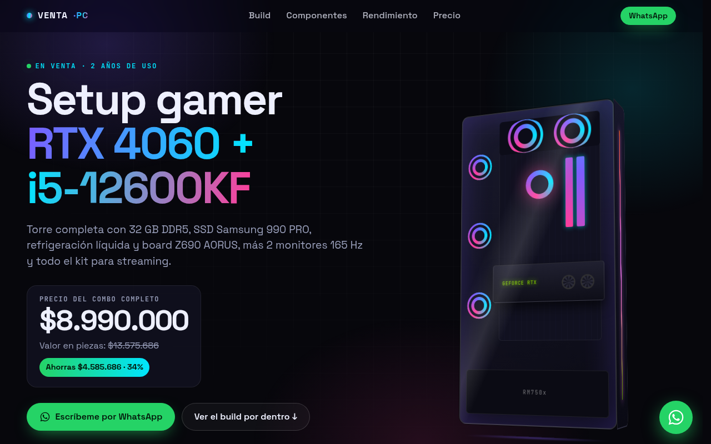

# 🖥️ ventaPC

Landing page para vender mi PC gamer completo (torre y periféricos). Está hecha con HTML, CSS y JavaScript puros, sin frameworks ni compilación, y se publica directo en GitHub Pages.

**Demo:** https://dylansrz.github.io/ventaPC/



## ✨ Qué hace

- **Un solo archivo de datos:** precios, componentes y textos viven en `js/data.js`, y la página se arma desde ahí.
- **Ahorro calculado:** suma los precios de referencia y muestra cuánto se ahorra frente al precio de venta.
- **Ficha por componente** con especificaciones y galería de imágenes.
- **Botón a WhatsApp** con un mensaje ya escrito.
- **Vista previa al compartir** con una imagen Open Graph propia.
- **Accesible al movimiento:** las animaciones respetan la preferencia de movimiento reducido del sistema.

## 🛠️ Stack

HTML · CSS · JavaScript vanilla · GitHub Pages

## 🚀 Cómo correrlo

No necesita instalación. Sirve la carpeta con cualquier servidor estático:

```bash
python -m http.server 8000
```

Luego abre http://localhost:8000.

## Editar la información

Todo está en **`js/data.js`**:

| Qué | Dónde |
| --- | --- |
| Número de WhatsApp | `config.whatsapp` (ej. `573001234567`, sin `+` ni espacios) |
| Precio de venta del combo | `config.precioVenta` (ej. `7500000`). Con `null` se muestra "Consultar" |
| Ciudad / forma de entrega | `config.ubicacion`, `config.entrega` |
| Vender por partes | `config.ventaPorPartes: true` |
| Precio de referencia de cada pieza | `precioReferencia` de cada componente |
| Marcar una pieza como vendida | `vendido: true` en ese componente |
| FPS por juego | lista `rendimiento` |

El ahorro (valor y %) se calcula solo: suma de los precios de referencia menos el precio de venta.

## Imágenes

- **Productos (imágenes oficiales):** están en `img/productos/` en formato `.webp`.
  La principal se llama como el `id` del producto (`gpu.webp`, `ram.webp`...) y las extra
  (`gpu-2.webp`...) aparecen como mini galería en la ficha; se listan en `galeria` dentro de `data.js`.
  Si falta alguna, la página muestra un ícono en su lugar.
- **Fotos reales:** súbelas a `img/reales/` y agrégalas en `fotosReales` dentro de `data.js`:
  ```js
  fotosReales: [
    { src: "img/reales/frontal.jpg", texto: "Vista frontal con RGB" },
  ],
  ```
  La sección "Fotos reales" aparece automáticamente cuando hay al menos una.

## Publicar en GitHub Pages

1. En GitHub: **Settings → Pages**.
2. En *Source* elige **Deploy from a branch**, rama **main**, carpeta **/ (root)**.
3. Espera 1–2 minutos y abre https://dylansrz.github.io/ventaPC/

## Vista previa al compartir

`og.png` es la imagen que aparece al pegar el link en WhatsApp o redes.
Se genera a partir de `tools/og.html` (captura de 1200×630).

## Licencia

El código está bajo licencia [MIT](LICENSE). Las imágenes de productos pertenecen a sus fabricantes.
